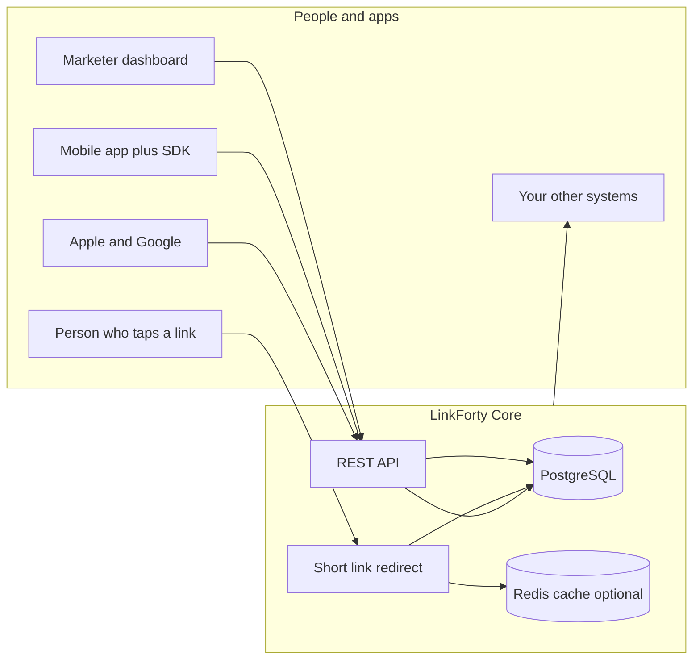
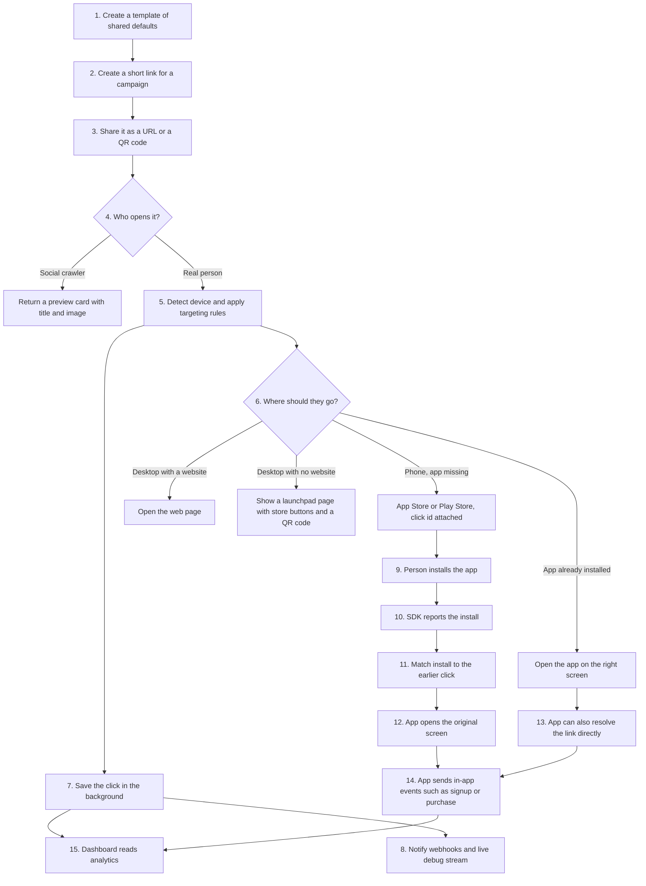
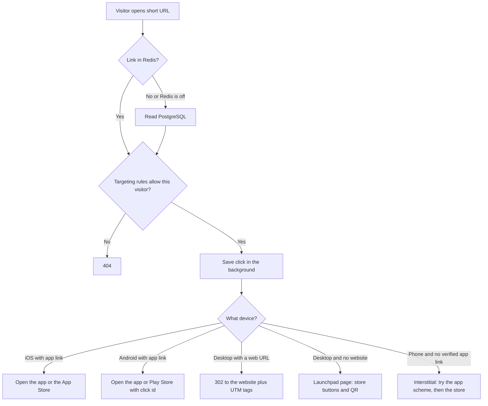
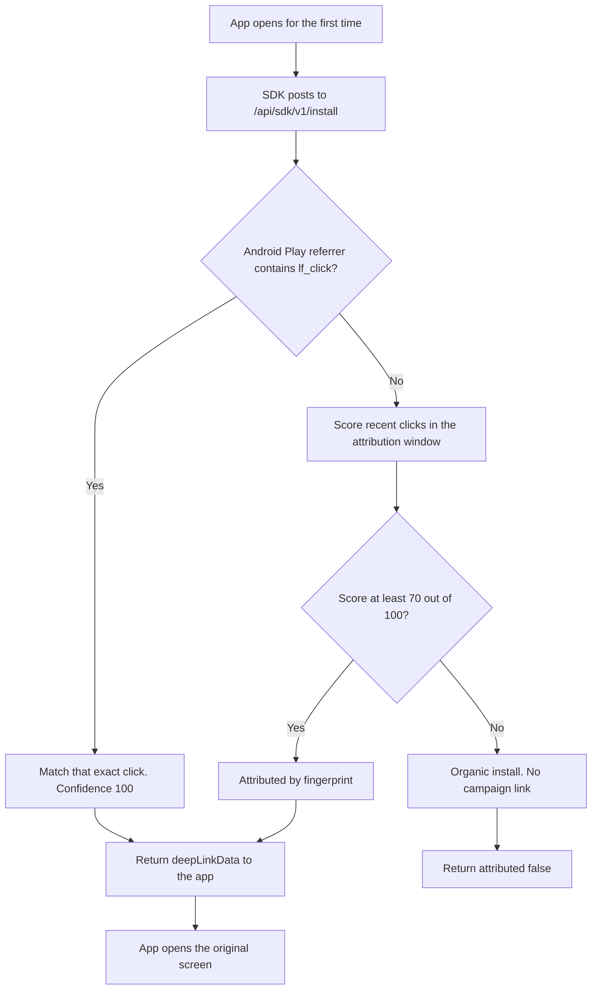
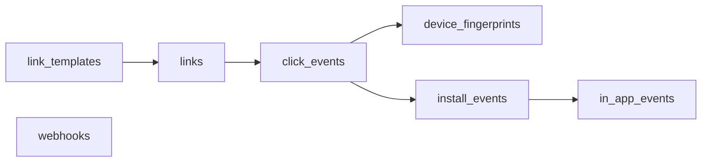

# LinkForty Core — Team Overview

A beginner-level walkthrough of what this project is, how the pieces fit together, and every feature group with its endpoints.

Use this document to present the project to other team members. Diagrams are written in [Mermaid](https://mermaid.js.org/) and render in GitHub, GitLab, and most Markdown preview tools.

---

## What this project is

**LinkForty Core** is a self-hosted deep-link engine. It is an open-source alternative to products such as Branch, AppsFlyer OneLink, and Firebase Dynamic Links (shut down in August 2025).

A deep link is a short URL (for example `https://go.yourdomain.com/abc123`) that:

1. Knows who clicked it (phone, tablet, or desktop).
2. Sends that person to the right place (the app, the App Store, Google Play, or a website).
3. Remembers the click, so if the person installs the app later, the app still opens the original page.
4. Records what happened, so marketing and product teams can see results.

The engine is a Node.js server (Fastify) that stores data in PostgreSQL and can optionally cache lookups in Redis. **Authentication is not included.** The host application adds its own login or API keys and may pass an optional `userId` so one database can serve many customers (multi-tenant).

**Stack**

| Piece | Role |
| --- | --- |
| Fastify (Node.js 20+) | HTTP API and public short-link server |
| PostgreSQL 14+ | Links, clicks, installs, events, webhooks, templates |
| Redis (optional) | Fast lookup cache. If Redis is down, the server reads PostgreSQL |
| Mobile SDKs (separate packages) | React Native, Expo, iOS (Swift), Android (Kotlin) call the SDK endpoints |

**License:** AGPL-3.0-only.

---

## How many feature groups?

There are **11 feature groups** and **39 endpoints** (38 HTTP routes plus 1 WebSocket).

| # | Group | Endpoints | Who calls it |
| --- | --- | --- | --- |
| 1 | Health | 2 | Load balancers, Docker, ops |
| 2 | Links | 6 | Dashboard or backend that creates campaigns |
| 3 | Templates | 6 | Dashboard that sets shared defaults |
| 4 | Public redirect | 2 | Anyone who taps a short link |
| 5 | Social preview | 1 | Facebook, Slack, iMessage, and similar crawlers |
| 6 | QR codes | 1 | Dashboard, print, and posters |
| 7 | Analytics | 2 | Dashboard charts |
| 8 | Webhooks | 6 | Your other systems (CRM, data warehouse, Slack) |
| 9 | Mobile SDK | 6 | The app, through the LinkForty SDK |
| 10 | App association files | 2 | Apple and Google, once, when verifying the domain |
| 11 | Debug | 5 | Engineers testing routing (4 HTTP + 1 WebSocket) |
| | **Total** | **39** | |

---

## The big picture

Three kinds of callers talk to one server. The server decides where a person goes, writes a record, and notifies other systems.

**One sentence version:** a marketer creates a short link, a visitor taps it, the server routes them and stores the click, the app later asks “which link caused this install?”, and analytics plus webhooks report the result.

---

## End-to-end story (the flow to present first)

This is the full product journey. Every feature group below is one step of this story.

**Deferred deep linking** is steps 9–12. The person did not have the app at click time. After they install it, the app still learns which product, campaign, or invite the link pointed at.

---

## Group 1 — Health (2 endpoints)

**Purpose:** tell infrastructure whether the process is alive, and whether it is ready to take traffic.

**Use:** Docker health checks, Kubernetes probes, and load balancers. A liveness check must not fail just because the database blinked, or the orchestrator will kill a healthy process. A readiness check should fail when PostgreSQL cannot be reached, so new traffic is sent elsewhere.

| Method | Endpoint | What it does |
| --- | --- | --- |
| GET | `/health` | Liveness. Process is up. Does not touch the database. |
| GET | `/health/ready` | Readiness. Database must answer. Redis is reported when configured; a Redis failure is degraded, not unready, because the database is the fallback. |

---

## Group 2 — Links (6 endpoints)

**Purpose:** create and manage the short links that everything else hangs off.

**Use:** a campaign such as “summer sale, product 123” becomes one row: short code, iOS store URL, Android store URL, website fallback, in-app path (`/product/123`), UTM tags, country or device rules, expiry, and Open Graph title or image for social cards.

`userId` is optional. With it, each customer only sees their own links. Without it, the install is single-tenant.

| Method | Endpoint | What it does |
| --- | --- | --- |
| GET | `/api/links` | List links |
| GET | `/api/links/:id` | Get one link |
| POST | `/api/links` | Create a link and its short code |
| PUT | `/api/links/:id` | Update a link. The short code stays the same |
| POST | `/api/links/:id/duplicate` | Clone a link into a new short code |
| DELETE | `/api/links/:id` | Delete a link |

---

## Group 3 — Templates (6 endpoints)

**Purpose:** store reusable defaults so every new link does not repeat the same App Store URL, attribution window, and UTM tags.

**Use:** an e-commerce workspace creates one “product links” template. New links inherit the iOS app, Android app, website, and a 7-day attribution window. One template can be marked as the default. A public link can also be addressed as `/:templateSlug/:shortCode` when the same short code exists under more than one template.

| Method | Endpoint | What it does |
| --- | --- | --- |
| GET | `/api/templates` | List templates |
| GET | `/api/templates/:id` | Get one template |
| POST | `/api/templates` | Create a template |
| PUT | `/api/templates/:id` | Update a template |
| DELETE | `/api/templates/:id` | Delete a template |
| PUT | `/api/templates/:id/set-default` | Mark this template as the default |

---

## Group 4 — Public redirect (2 endpoints)

**Purpose:** the product itself. A person opens a short URL and is sent to the right destination. The click is recorded without slowing the redirect.

**Use:** SMS, email, ads, QR codes, and in-app shares. The short domain is the public face of LinkForty.

| Method | Endpoint | What it does |
| --- | --- | --- |
| GET | `/:shortCode` | Look up the code and redirect |
| GET | `/:templateSlug/:shortCode` | Same lookup, scoped to a template slug |

### What happens on a click

Details worth saying out loud in a presentation:

- **Targeting rules** can limit a link by country, device, or language. A visitor who does not match gets a 404.
- **UTM parameters** (`utm_source`, `utm_medium`, and so on) are appended to the destination so the website’s own analytics still work.
- **Android Play Store** visits carry `lf_click=<click id>` inside the Play install referrer. That is how a later install is tied to this exact tap.
- **Launchpad** is a hosted landing page for visitors who would otherwise have nowhere to go: app name, store buttons, and a QR code to continue on a phone.
- **Web-link hosts** can be configured so every device gets a plain redirect to the website, with no app behavior.

---

## Group 5 — Social preview (1 endpoint)

**Purpose:** when someone pastes a short link into Slack, iMessage, Facebook, or LinkedIn, the chat app’s crawler should see *your* title, description, and image, not a redirect to a random store page.

**Use:** campaign links that need a proper share card. Real browsers are still redirected. Only known crawler user-agents receive the preview HTML.

| Method | Endpoint | What it does |
| --- | --- | --- |
| GET | `/:shortCode/preview` | Open Graph HTML for social crawlers |

The same preview behavior is also applied on the main short-link route when the user-agent is a known bot, so the share card works even if the crawler never calls `/preview` directly.

---

## Group 6 — QR codes (1 endpoint)

**Purpose:** turn a short link into an image people can scan from a poster, packaging, a slide, or a desktop launchpad.

**Use:** offline campaigns. The QR encodes the short URL, so a scan follows the same redirect flow as a tap. PNG is the default; SVG is available for print.

| Method | Endpoint | What it does |
| --- | --- | --- |
| GET | `/api/links/:id/qr` | PNG or SVG QR code. Use `?format=svg` for SVG |

---

## Group 7 — Analytics (2 endpoints)

**Purpose:** answer “what happened?” from the clicks already stored in PostgreSQL.

**Use:** a dashboard showing clicks over time, device mix, countries, and the top links. Query with `?days=30` (or `7`, and so on). Bot clicks are classified so charts can focus on people.

| Method | Endpoint | What it does |
| --- | --- | --- |
| GET | `/api/analytics/overview` | Totals across links |
| GET | `/api/analytics/links/:linkId` | Stats for one link |

Analytics is a read model. It does not change routing. Clicks are written by the redirect and by the SDK resolve endpoint.

---

## Group 8 — Webhooks (6 endpoints)

**Purpose:** push events to systems you already run, instead of making those systems poll the analytics API.

**Use:** send a click, an install, or an in-app conversion to a CRM, a data pipeline, or Slack. Each webhook has a secret. Payloads are signed with HMAC-SHA256 in the `X-LinkForty-Signature` header so the receiver can reject forgeries. Failed deliveries are retried.

Typical events: `click_event`, `install_event`, `conversion_event`.

| Method | Endpoint | What it does |
| --- | --- | --- |
| GET | `/api/webhooks` | List webhooks |
| GET | `/api/webhooks/:id` | Get one webhook, including its secret |
| POST | `/api/webhooks` | Create a webhook. The secret is generated for you |
| PUT | `/api/webhooks/:id` | Update URL, events, retry count, or timeout |
| DELETE | `/api/webhooks/:id` | Delete a webhook |
| POST | `/api/webhooks/:id/test` | Send a test payload |

---

## Group 9 — Mobile SDK (6 endpoints)

**Purpose:** let the installed app finish the story the short link started.

**Use:** the official SDKs call these routes. You rarely call them from a dashboard.

Two different moments matter:

1. **The app is already installed.** The link opens the app. The SDK calls **resolve** and receives the in-app path, custom parameters, and UTM tags. This click is also recorded.
2. **The app was not installed.** The person went to the store, installed, and opened the app. The SDK calls **install**. Core matches that install to the earlier click and returns the same kind of deep-link payload. The app then navigates to the original screen. That is deferred deep linking.

Later, the app calls **event** for actions worth counting (signup, add to cart, purchase).

| Method | Endpoint | What it does |
| --- | --- | --- |
| GET | `/api/sdk/v1/health` | SDK connectivity check |
| GET | `/api/sdk/v1/resolve/:shortCode` | Deep-link JSON for an app that is already installed |
| GET | `/api/sdk/v1/resolve/:templateSlug/:shortCode` | Same, scoped to a template |
| POST | `/api/sdk/v1/install` | Report a new install and get matched deep-link data |
| GET | `/api/sdk/v1/attribution/:fingerprint` | Look up a previous match. Useful for debugging or a delayed check |
| POST | `/api/sdk/v1/event` | Record an in-app event tied to an install |

### How an install is matched to a click

**Fingerprint score** (used when there is no Play click id, including iOS):

| Signal | Points |
| --- | --- |
| IP address | 40 |
| User agent | 30 |
| Timezone | 10 |
| Language | 10 |
| Screen size | 10 |

A match needs **70 or more**. The default window is **168 hours (7 days)** and can be changed per link. If several links from the same network also clear the threshold, `competingLinks` tells the app the match is less certain.

---

## Group 10 — App association files (2 endpoints)

**Purpose:** prove to Apple and Google that this domain is allowed to open your app without a browser prompt.

**Use:** iOS Universal Links and Android App Links. You set team id, bundle id, package name, and signing certificate fingerprints in environment variables. Phones fetch these files from the domain once. After that, a tap on `https://go.yourdomain.com/abc123` can open the app directly.

| Method | Endpoint | What it does |
| --- | --- | --- |
| GET | `/.well-known/apple-app-site-association` | File Apple reads for Universal Links |
| GET | `/.well-known/assetlinks.json` | File Google reads for App Links |

If these files are missing or wrong, taps still work, but they go through the browser, the store, or the interstitial instead of opening the app immediately.

---

## Group 11 — Debug (5 endpoints)

**Purpose:** let engineers see a routing decision without sending a real user through it, and watch clicks as they happen.

**Use:** “What would an iPhone in Germany see for this link?” The simulate route answers that and does not write a click. The live socket streams real clicks to an inspector, optionally filtered by user or link. The comment in the route file marks this area as a premium cloud-oriented feature; the routes are still part of this server.

| Method | Endpoint | What it does |
| --- | --- | --- |
| POST | `/api/debug/simulate` | Dry-run a click with a fake device, country, or language |
| GET | `/api/debug/user-agents` | Sample user-agent strings for tests |
| GET | `/api/debug/countries` | Sample country codes for tests |
| GET | `/api/debug/languages` | Sample language codes for tests |
| WebSocket | `/api/debug/live` | Stream click events. Optional query: `userId`, `linkId` |

---

## Where the data lives

Tables are created automatically on first startup. There is no separate migration step for a new install.

| Table | Holds |
| --- | --- |
| `link_templates` | Shared defaults for a family of links |
| `links` | Each short link and its destinations |
| `click_events` | One row per tap, including place, device, and bot flag |
| `device_fingerprints` | Signals used to match a later install |
| `install_events` | App installs and which link they matched |
| `in_app_events` | Signup, purchase, and other events from the SDK |
| `webhooks` | Where to POST those events, and the signing secret |

---

## Who owns which step

A useful slide when several teams are in the room.

| Team | They care about |
| --- | --- |
| Marketing | Links, templates, QR codes, UTM tags, analytics |
| Mobile | SDK resolve, install attribution, association files, in-app events |
| Backend / platform | Health, PostgreSQL, Redis, webhooks, bringing your own auth |
| Growth / data | Click, install, and conversion events, webhook delivery |

---

## What this server deliberately does not do

- It does not log users in. Put an API key or session check in front of `/api/*` in the host app. Public routes (`/:shortCode`, `/.well-known/*`, SDK routes) stay reachable without that login.
- It does not render the marketing dashboard. It is the API and the redirect engine a dashboard calls.
- It does not ship the mobile app. The SDKs are separate packages that call group 9.

---

## 60-second presentation script

> LinkForty Core is our self-hosted deep-link engine. We create a short link, share it as a URL or QR code, and the server sends each visitor to the app, the store, or the website based on their device. Every tap is stored. If they install the app later, the SDK asks Core which link they came from, and the app opens the original screen. Analytics and webhooks report clicks, installs, and purchases. There are 11 feature groups and 39 endpoints. Auth is ours to add. The data stays in our PostgreSQL.
